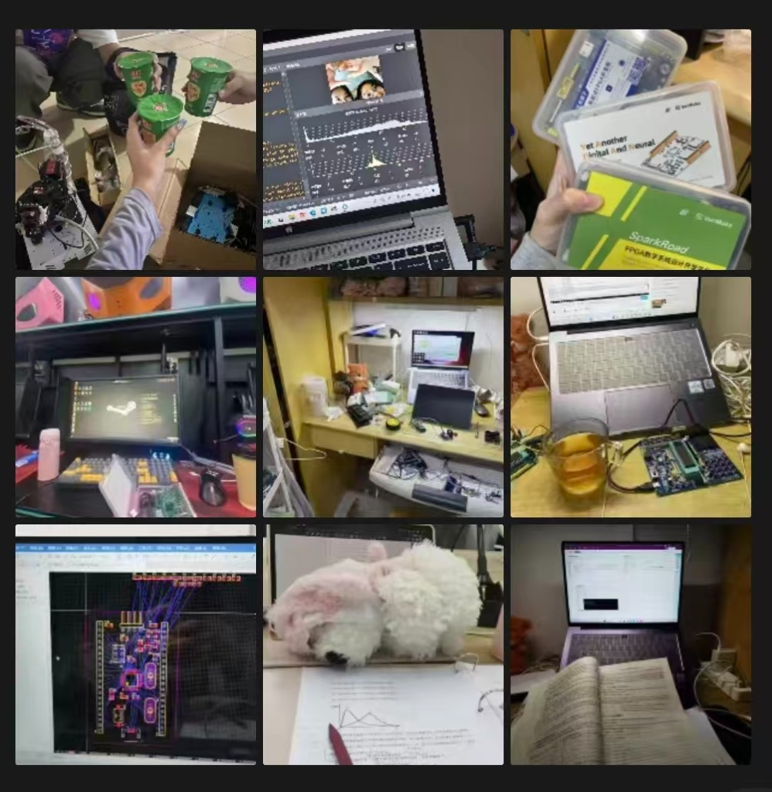

在这个大模型算力不断增长的时代，解决一个小小的 bug 已经是一件很简单的事了。好像不管遇到什么难题，最终都可以交给 AI 来解决。

最近看到师弟师妹们准备嵌入式比赛，用 AI 就能把整个流程跑通，做出非常不错的项目，整届的水平都非常高。在惊叹之余，我也忍不住回想起刚入学时的自己。

那时候，还没有豆包，没有大模型，也没有 Agent。  
那时的我们，只有 CSDN、EETOP 和 Stack Overflow。

每一场比赛，都是一次重新学习的机会。我们会去 B 站找各种各样的视频和教程，大家围在一起学、一起讨论、一起分享。等有了一点基础，就开始自己看论文、看油管视频，去寻找新的项目方向。

然后，我们就用自己已有的那点知识，一点点去把项目搭起来。遇到不会的地方、卡壳的地方，大家就凑在一起想办法，积极地找人讨论，或者翻开厚厚的英文芯片手册去查。虽然当时做出来的作品不一定有多完美，效率也没有现在这么高，但在实践里真真切切学到的东西，以及那种真正去摸清问题、解决问题的过程，现在想来依然觉得非常珍贵。

而现在，大家做项目的习惯变了。  
往往是先找开源代码，然后交给 AI 去做，接下来就是不断地跟 AI 聊天、改错。

比赛的难度，好像不再取决于你的技术创新，也不是你付出了多少工作量，更多的是看你用的模型是不是最好的？你花了多少 Token？可在这个过程里，真正属于我们自己的东西又有多少呢？

当然，AI 确实给我们带来了非常多的便利。我们也没必要再像以前那样“古法编程”，花大量的时间去写一些很基础的代码。但我觉得有一个很明显的问题是：**我们的上限，好像慢慢变成了 AI 的上限。**

> 难道不应该是，我们的上限在哪里，AI 的上限才在哪里吗？

现在去问一个项目的意义、问它的技术创新点，听到的往往是很标准的“AI 味”回答，或者是自己总结出来的 AI 式回答。对于经历过从零摸索的我们来说，自然一听就能分辨出来。但对于现在刚接触这个领域的师弟师妹们来说，他们能分得清吗？

他们学过 **STFW**（Search The F\*\*\*ing Web）和 **RTFM**（Read The F\*\*\*ing Manual）吗？  
在习惯了把问题直接丢给对话框的今天，他们还会自己去网页里耐心搜索答案吗？还会静下心去读一读官方手册吗？

他们没有经历过完全不靠 AI 去做一件事的日子，大概也很难想象，在那个没有 AI 的时代，大家是怎样一点点摸索，去完成一个那么庞大的工程项目的。

我还记得以前为了解决一个 bug，可以花上一整天，甚至是好几天。那个过程真的是既煎熬，同时又让人非常兴奋。每一次修改完代码，心里都抱着期待：也许下一次编译，我的代码就能跑通了。

但现在，这一切好像都停留在了和 AI 的对话里。一切都变得很快、很顺利，却总觉得少了点什么。到底少了点什么呢？
